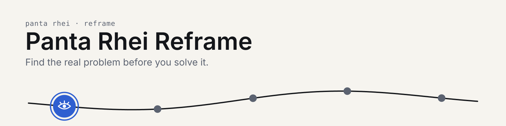
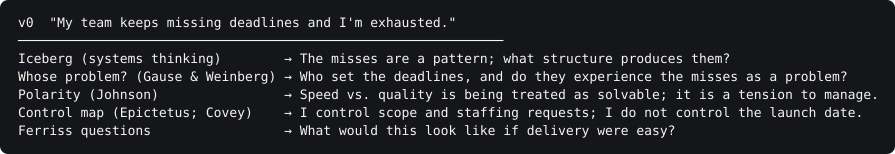

<p align="center"></p>

# Panta Rhei Reframe

A reframing and problem-definition skill for Claude, Claude Code and Hermes: 26 lenses that find the real problem before you solve it.

<p align="center">
  <a href="#install"></a>
  
  
  
</p>

## What it does

Most bad solutions start with a well-solved wrong problem. Panta Rhei Reframe takes the problem as you first state it, turns it through four to six lenses from coaching, systems thinking and design practice, and marks the reframes that would change what you work on. You get back a one-sentence problem statement with an owner, ready to brainstorm, diagnose or decide.

## Try it

Say any of these after installing:

> My team keeps missing deadlines and I'm exhausted. What's really going on?
> Help me figure out what problem I'm actually trying to solve with this job search
> Everyone agrees the fix is a reorg. Are we solving the right problem?

## How it works: The Lens Rotation

Each lens restates the problem in one line. The ones that change what gets worked on are marked ●, and the last step writes them into a single problem statement (v1) that the next module can use.

<p align="center"></p>

<p align="center"></p>

1. **Take it as stated:** your words become v0, unedited.
2. **Read the domain:** personal, team, product or system, and whether it is a problem or a tension to manage.
3. **Rotate the lenses:** four to six, chosen for the situation, one line each.
4. **Write v1:** one sentence, with whose problem it is.

## Install

**Claude Code**
```
/plugin marketplace add fairyanna85/pantarhei-reframe
/plugin install pantarhei-reframe@pantarhei-reframe
```
Or install the whole family: `/plugin marketplace add fairyanna85/pantarhei`.

**Hermes Agent**
```
hermes skills install https://github.com/fairyanna85/pantarhei-reframe
```

**Claude apps (web, desktop, mobile)**
1. Download [`pantarhei-reframe.zip`](https://github.com/fairyanna85/pantarhei-reframe/releases/latest/download/pantarhei-reframe.zip).
2. Go to **Customize > Skills**, click **+**, then **+ Create skill**, then **Upload a skill**, and choose the ZIP.
3. Turn the skill on. Code execution and file creation must be enabled (Settings > Capabilities).

**Any Agent Skills client** (Codex, Cursor and others): copy `skills/pantarhei-reframe/` into your
client's skills folder.

## What's inside

26 methods of its own, plus 14 shared with sister skills and 28 audit models from the shared library. Every method carries an evidence class and a named failure mode.

### Question banks

- **Testing the impossible (17 questions)** — A set of questions that test whether constraints are real: run the opposite for a short time, imagine the easy version, solve only by removing, price…
- **Problem-solving questions** — Five questions that move attention from complaint to agency: what is useful in this problem, what is not yet right, what will I start doing, what…
- **Influence and seasons** — Questions about who and what is shaping you (who am I around, what are they doing to me, is that acceptable) and about timing: which season of…
- **Seven coaching questions** — A short sequence that pulls the real issue to the surface: what is on your mind, what else, what is the real challenge for you here, what do you…
- **Socratic questioning** — Six families of questions: clarify the concept, probe assumptions, probe evidence, consider other viewpoints, trace implications, question the…
- **Clean language** — Use the person's own words and metaphors back to them with minimal, content-free questions ('and what kind of X is that X?').
- **Whose problem is it?** — A problem is a difference between things as desired and things as perceived.

### Restate the problem

- **Question burst** — For four minutes, generate only questions about the problem, no answers and no preamble.
- **Frame-storming** — Before solving, look outside the frame, rethink the goal, examine bright spots, look in the mirror at your own role, and take the other parties'…
- **How might we** — Rewrite a complaint as an open question starting 'how might we'.
- **Why and what's stopping** — Ask 'why' to move up to the broader goal, 'what is stopping us' to move down to concrete obstacles.
- **5W2H problem statement** — Who, what, where, when, why, how and how much, answered in one paragraph.
- **Discover, then define** — Widen first (gather, observe, listen without narrowing), then narrow to a defined problem statement.
- **The Hamming question** — What are the most important problems in your area, and why are you not working on them?

### Read the situation

- **Sense-making domains** — Classify the situation as clear (best practice exists), complicated (experts can analyse it), complex (cause is only visible in hindsight, so probe…
- **Tame or wicked** — A wicked problem has no definitive formulation, no stopping rule and no right answer, only better or worse ones, and every attempt changes it.
- **Problem or polarity?** — Some 'problems' are pairs of interdependent goods (stability and change, centralised and local) that cannot be solved, only managed over time.
- **Iceberg model** — Look below the event to the pattern, below the pattern to the structure producing it, below the structure to the beliefs that hold the structure in…
- **Jobs to be done** — People hire a product or a solution to make progress in a specific circumstance.
- **What is in my control** — Sort every element of the situation into what you control, what you influence and what you neither control nor influence.
- **Stakeholder map** — List everyone affected and everyone who can affect the outcome, with what each wants and how much power each has.

### Check your own lens

- **Ladder of inference** — We select data, add meaning, make assumptions, draw conclusions and act, often in seconds.
- **Retrospective sensemaking** — People make sense of a situation by acting and then building a plausible story around the results; plausibility wins over accuracy.
- **Orient before acting** — Orientation (the lens of experience, culture and prior beliefs) shapes what you observe and what you decide.
- **Humble inquiry** — Ask questions to which you do not already know the answer, out of genuine curiosity about the other person's view.
- **Name the feeling first** — Putting a precise word to an emotion lowers its intensity.

### Shared with sister skills

- **Key assumptions check** — List every assumption the conclusion rests on, rate how well supported each is, and name what would make it false.
- **Diverge, then converge** — Generate first with judgment switched off, evaluate afterwards in a separate pass.
- **Hold both opposites** — Conceive two opposite or contradictory ideas as true at the same time and build from the tension rather than choosing one.
- **Morphological box** — List the independent dimensions of a solution, list options on each, then combine one option per dimension.
- **One-way and two-way doors** — Reversible decisions should be made fast and by few people; irreversible ones slowly and carefully.
- **Scenario planning** — Pick the two most uncertain and most important drivers, cross them into four plausible futures, and test each option against all four.
- **Value-focused thinking** — Start from what you value, not from the options available.
- **Weighted criteria** — Name the criteria, weight them before scoring, score each option, sum.
- **Inference to the best explanation** — From a surprising fact, infer the hypothesis that would make it unsurprising.
- **Causal loop diagram** — Draw variables and the arrows between them, marking reinforcing and balancing loops.
- **Is / is not analysis** — Specify where, when and to what extent the problem occurs and, for each, where it could occur but does not.
- **Issue tree (MECE)** — Break the question into sub-questions that are mutually exclusive and collectively exhaustive, then repeat down to questions small enough to answer…
- **Leverage points** — Twelve places to intervene in a system, from weak (parameters, numbers) to strong (rules, goals, paradigm).
- **Smallest test** — Find the cheapest experiment that would change what you do next and run it before building anything larger.

### Audit models (28)

- **Map is Not the Territory** — Any model, map or metric is a simplification that leaves things out.
- **Circle of Competence** — Know the areas where your judgment has a track record and where it does not.
- **First Principles Thinking** — Strip a problem down to what is known to be true, discarding convention and analogy, then reason upward from there.
- **Inversion** — Approach the problem backwards: ask what would make it fail, or what you want to avoid, then steer away from that.
- **Hanlon's Razor** — Before concluding someone acted out of malice, check whether carelessness, ignorance or confusion would explain it.
- **Relativity** — What you see depends on where you stand.
- **Thermodynamics** — Any organised system runs down unless energy is put in to maintain it.
- **Ecosystems** — An ecosystem is a web of interdependent parts.
- **Self-Preservation** — People and organisations act to protect their own survival, status and position.
- **Incentives** — People respond to what they are rewarded and punished for, not to what they are asked to do.
- **Feedback Loops** — When an output feeds back as an input, a loop forms.
- **Equivalence** — Different inputs or routes can lead to the same result.
- **Global and Local Maxima** — A position can be the best within reach and still well below the best available.
- **Scarcity** — When something is in limited supply, people value it more and compete for it.
- **Monopoly and Competition** — Competition pushes prices down and drives improvement; a monopoly captures profits and can fund long bets.
- **Audience** — Every message is received by a particular audience with its own knowledge and expectations.
- **Genre** — A genre is a set of conventions that tells the audience what to expect.
- **Framing** — How a choice is presented changes how people respond to it, even when the facts are the same.
- **Representation** — A representation stands in for something else and always selects and distorts.
- **Character** — Character is the pattern of choices a person makes, most visible under pressure.
- **Seeing the Front** — Reports pass through filters and delays.
- **Asymmetric Warfare** — A weaker party can beat a stronger one by refusing to fight on the stronger party's terms.
- **Envy and Jealousy** — People compare their position with others and resent those who have more.
- **Tendency to Stereotype** — Sorting people and things into categories saves effort but erases individual differences.
- **Language Instinct** — Humans acquire language naturally and think partly through it.
- **Relative Satisfaction/Misery** — Satisfaction depends on comparison with expectations, past experience and other people more than on absolute conditions.
- **Overestimate Consistency of Behavior** — We attribute others' behaviour to their personality and underweight the situation they were in.
- **Tendency to Want to Do Something** — There is a strong pull to act, especially when watched or under pressure, even when waiting would be better.

## How honest is it?

Every method carries an evidence class (`formal`, `empirical`, `heuristic`, `analogical`) and its
origin, and the skill caps its claims by them. Practitioner methods are labelled as such.
Most lenses here are practitioner heuristics: they point attention, they do not establish facts. The question banks are paraphrased and link to their sources.

## The Panta Rhei pack (optional)

Each module works on its own. The pack installs all five plus Panta Rhei, the hub that runs them
end to end.

| | Module | For |
|---|---|---|
| 🔵 | [Panta Rhei Reframe](https://github.com/fairyanna85/pantarhei-reframe) | Working out what the real problem is |
| 🟣 | [Panta Rhei Brainstorm](https://github.com/fairyanna85/pantarhei-brainstorm) | Brainstorming and idea generation |
| 🟢 | [Panta Rhei Solve](https://github.com/fairyanna85/pantarhei-solve) | Structuring and diagnosing problems |
| 🔴 | [Panta Rhei Challenge](https://github.com/fairyanna85/pantarhei-challenge) | Red-teaming ideas and claims |
| 🟡 | [Panta Rhei Decide](https://github.com/fairyanna85/pantarhei-decide) | Making the call |
| ⚫ | [Panta Rhei](https://github.com/fairyanna85/pantarhei) | The pack: all five, end to end |

## Credits and license

Methods are credited to their originators in `catalog.json` and on every card; all descriptions are
our own wording. Code: MIT. Method text: CC BY 4.0. Propose a method: see [CONTRIBUTING.md](CONTRIBUTING.md).
