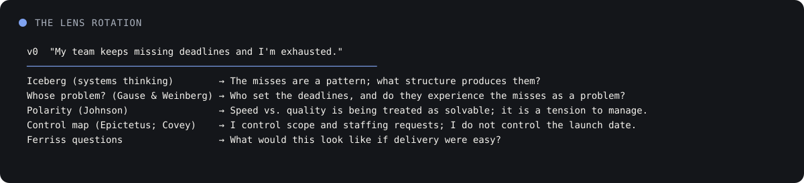

<p align="center"></p>

# Panta Rhei Reframe

A reframing and problem-definition skill for Claude, Claude Code and Hermes: 26 lenses that find the real problem before you solve it.

<p align="center">
  <a href="#install"></a>
  
  
  
</p>

## What it does

Most bad solutions start with a well-solved wrong problem. Panta Rhei Reframe takes the problem as you first state it, turns it through four to six lenses from coaching, systems thinking and design practice, and marks the reframes that would change what you work on. You get back a one-sentence problem statement with an owner, ready to brainstorm, diagnose or decide.

## Try it

Say any of these after installing:

> My team keeps missing deadlines and I'm exhausted. What's really going on?
> Help me figure out what problem I'm actually trying to solve with this job search
> Everyone agrees the fix is a reorg. Are we solving the right problem?

## How it works: The Lens Rotation

Each lens restates the problem in one line. The ones that change what gets worked on are marked ●, and the last step writes them into a single problem statement (v1) that the next module can use.

<p align="center"></p>

```
v0  "My team keeps missing deadlines and I'm exhausted."
──────────────────────────────────────────────────────────────
Iceberg (systems thinking)        → The misses are a pattern; what structure produces them?
Whose problem? (Gause & Weinberg) → Who set the deadlines, and do they experience the misses as a problem?
Polarity (Johnson)                → Speed vs. quality is being treated as solvable; it is a tension to manage.
Control map (Epictetus; Covey)    → I control scope and staffing requests; I do not control the launch date.
Ferriss questions                 → What would this look like if delivery were easy?
```

1. **Take it as stated:** your words become v0, unedited.
2. **Read the domain:** personal, team, product or system, and whether it is a problem or a tension to manage.
3. **Rotate the lenses:** four to six, chosen for the situation, one line each.
4. **Write v1:** one sentence, with whose problem it is.

## Install

**Claude Code**
```
/plugin marketplace add fairyanna85/pantarhei-reframe
/plugin install pantarhei-reframe@pantarhei-reframe
```
Or install the whole family: `/plugin marketplace add fairyanna85/pantarhei`.

**Hermes Agent**
```
hermes skills install https://github.com/fairyanna85/pantarhei-reframe
```

**Claude apps (web, desktop, mobile)**
1. Download [`pantarhei-reframe.zip`](https://github.com/fairyanna85/pantarhei-reframe/releases/latest/download/pantarhei-reframe.zip).
2. Go to **Customize > Skills**, click **+**, then **+ Create skill**, then **Upload a skill**, and choose the ZIP.
3. Turn the skill on. Code execution and file creation must be enabled (Settings > Capabilities).

**Any Agent Skills client** (Codex, Cursor and others): copy `skills/pantarhei-reframe/` into your
client's skills folder.

## What's inside

| Group | Methods |
|---|---|
| **Question banks** | Testing the impossible (17 questions) · Problem-solving questions · Influence and seasons · Seven coaching questions · Socratic questioning · Clean language · Whose problem is it? |
| **Restate the problem** | Question burst · Frame-storming · How might we · Why and what's stopping · 5W2H problem statement · Discover, then define · The Hamming question |
| **Read the situation** | Sense-making domains · Tame or wicked · Problem or polarity? · Iceberg model · Jobs to be done · What is in my control · Stakeholder map |
| **Check your own lens** | Ladder of inference · Retrospective sensemaking · Orient before acting · Humble inquiry · Name the feeling first |

## How honest is it?

Every method carries an evidence class (`formal`, `empirical`, `heuristic`, `analogical`) and its
origin, and the skill caps its claims by them. Practitioner methods are labelled as such.
Most lenses here are practitioner heuristics: they point attention, they do not establish facts. The question banks are paraphrased and link to their sources.

## The Panta Rhei pack (optional)

Each module works on its own. The pack installs all five plus Panta Rhei, the hub that runs them
end to end.

| | Module | For |
|---|---|---|
| 🔵 | [Panta Rhei Reframe](https://github.com/fairyanna85/pantarhei-reframe) | Working out what the real problem is |
| 🟣 | [Panta Rhei Brainstorm](https://github.com/fairyanna85/pantarhei-brainstorm) | Brainstorming and idea generation |
| 🟢 | [Panta Rhei Solve](https://github.com/fairyanna85/pantarhei-solve) | Structuring and diagnosing problems |
| 🔴 | [Panta Rhei Challenge](https://github.com/fairyanna85/pantarhei-challenge) | Red-teaming ideas and claims |
| 🟡 | [Panta Rhei Decide](https://github.com/fairyanna85/pantarhei-decide) | Making the call |
| ⚫ | [Panta Rhei](https://github.com/fairyanna85/pantarhei) | The pack: all five, end to end |

## Credits and license

Methods are credited to their originators in `catalog.json` and on every card; all descriptions are
our own wording. Code: MIT. Method text: CC BY 4.0. Propose a method: see [CONTRIBUTING.md](CONTRIBUTING.md).
